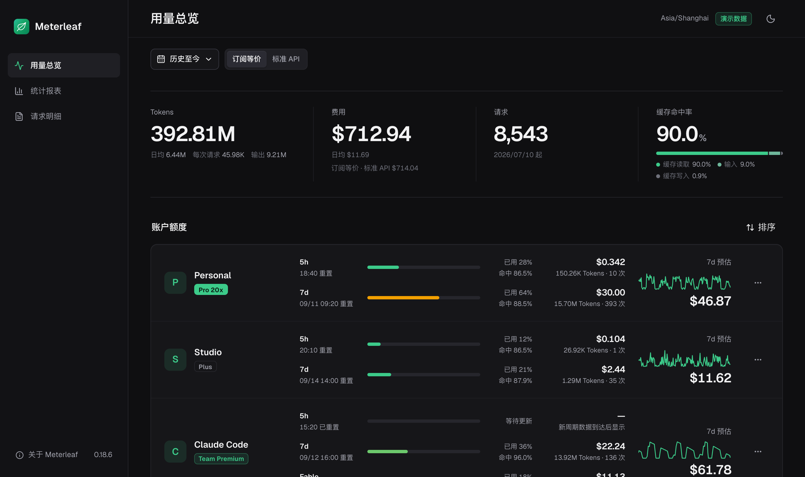
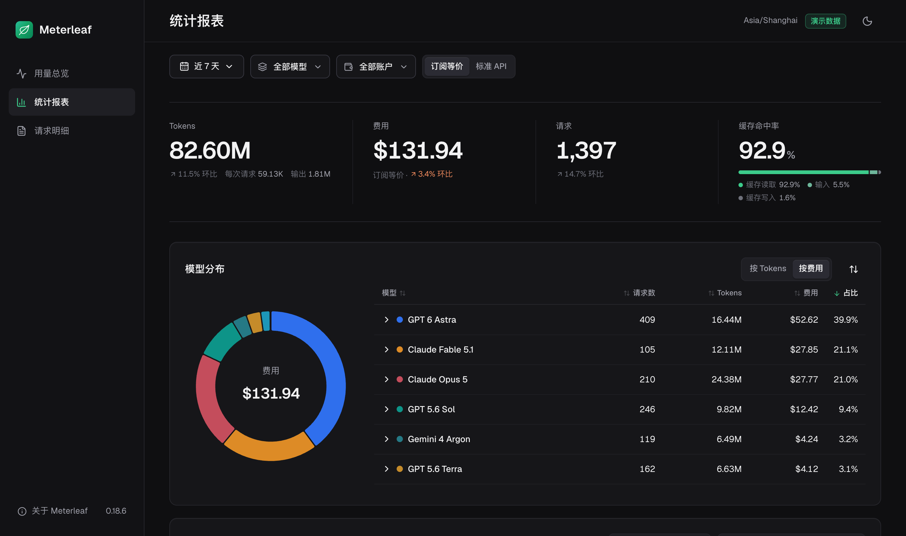
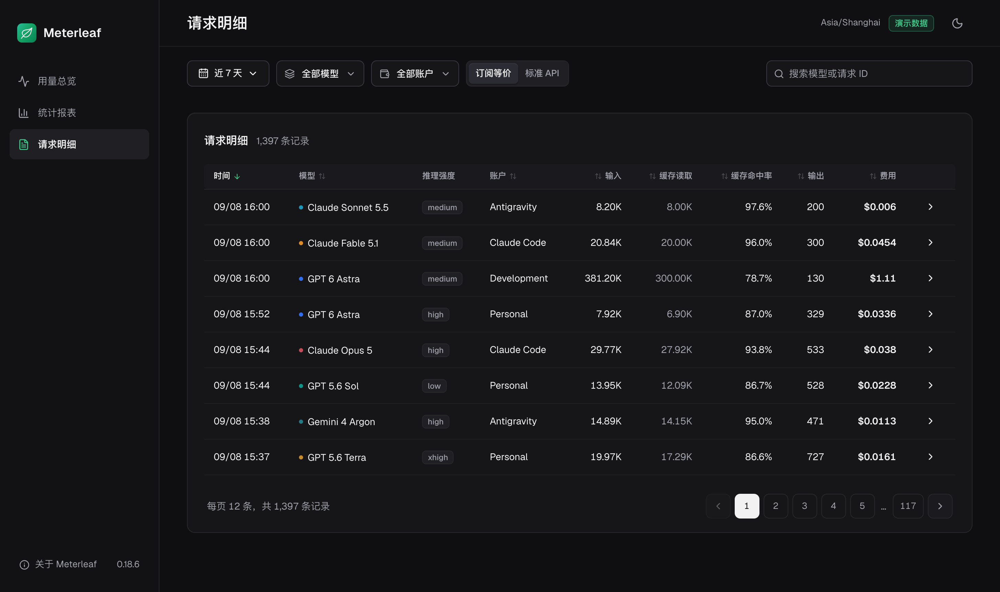
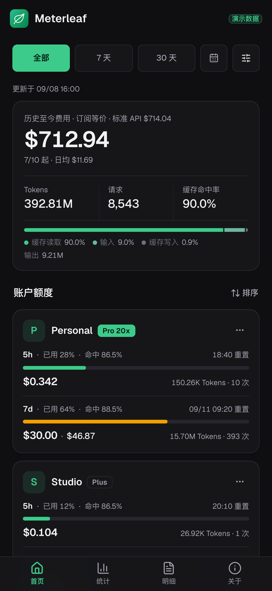
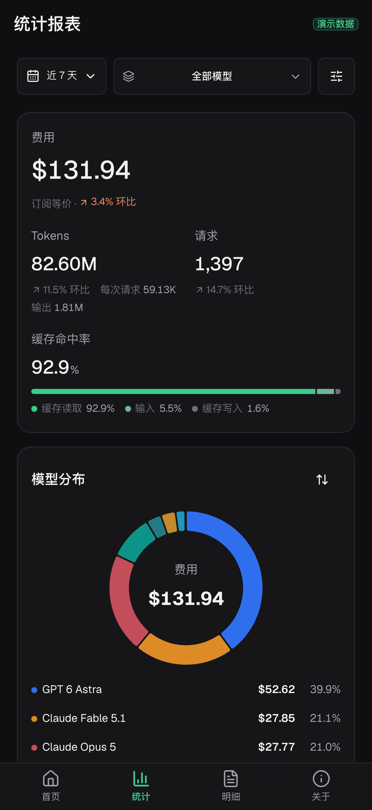
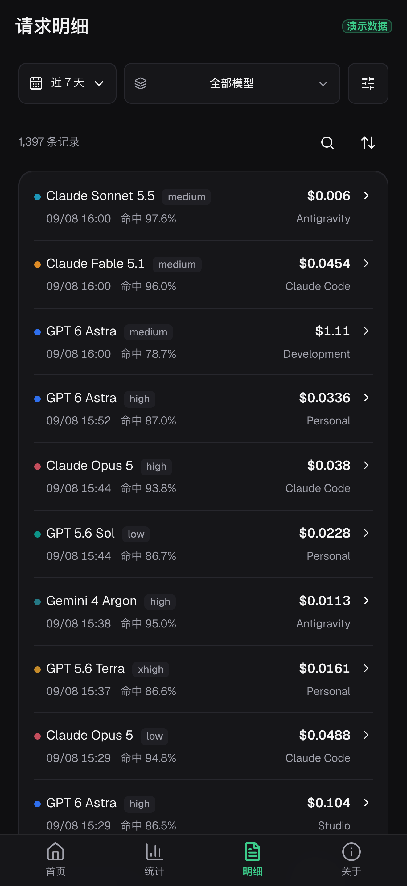

# Meterleaf

AI 用量账本，账户额度、Token 消耗、费用估算、响应性能与多维统计。

Meterleaf 可以只读采集一个 Sub2API PostgreSQL 实例，也可以接收本机采集器推送的 Claude Code、Codex、OpenCode、Antigravity CLI 与 omp 本地用量，以及 CLIProxyAPI（CPA）插件账本，并可选轮询 OpenCode Go 额度。各来源可单独或同时使用，用量保存到本地 SQLite 并生成独立报表。它不代理模型请求、不修改上游，也不直接调用 OpenAI 或 Anthropic 接口；账本服务单个容器即可运行，CPA 接入另启一个同步容器。

## 能做什么

- **用量总览**，默认查看历史至今的 Tokens、费用、请求数和缓存命中率，可切换到今天、近 7 天、近 30 天或自定义日期；下方展示同一范围的消耗趋势和模型分布。
- **账户额度**，按当前周期展示 5 小时、7 天、Fable 周额度、月度（1m）与 Antigravity 双池（Gemini 与 Claude）窗口、周期缓存命中率、重置时间及整周期预估；支持拖拽排序、重命名、手动设置套餐、合并多来源账户、归档和删除。
- **统计报表**，顶部展示范围摘要与环比，下方提供模型分布，并在分组汇总中支持「用量与费用」与「响应性能」（平均首字延迟、平均总耗时与生成速度 tok/s）双视角，按小时、天、周、模型或账户聚合。
- **请求明细**，查看模型、推理强度、账户、Token 拆分、单条缓存命中率与费用；点击条目查看来源证据、计价依据与耗时速度详情。
- **本机采集器**，一台 Mac 上用单个采集器统一读取 Claude Code、Codex、OpenCode、Antigravity 与 omp 的本地记录、套餐和额度快照并推送到 Meterleaf，同时提供本机 OTEL 日志中继与供本机会话读取的额度摘要。
- **独立估值**，以版本化价格表独立估算订阅等价 USD 与标准 API USD，支持私有模型别名和路由前缀配置，与上游网关扣费严格区分。

支持浅色/深色与三套强调配色（翠绿、靛蓝、黑白）、移动端 App/侧栏双布局、PWA 安装和可选 GitHub 登录；同步与索引重建都在后台进行，已有报表继续可读。

## 界面预览

### Web



<details>
<summary>统计报表</summary>



</details>

<details>
<summary>请求明细</summary>



</details>

### 移动端

| 用量总览                                                                       | 统计报表                                                                      |
| ------------------------------------------------------------------------------ | ----------------------------------------------------------------------------- |
|  |  |

<details>
<summary>请求明细</summary>



</details>

## 快速开始

Meterleaf 支持以下数据来源，至少配置一种。

- **Sub2API 网关**，在 `.env` 填写 `SUB2API_DATABASE_URL`。数据库账号只需读取 `public.accounts` 和 `public.usage_logs`，不需要写权限。
- **本机采集器（Claude Code、Codex、OpenCode、Antigravity 与 omp）**，在 `.env` 填写采集器生成的 `METERLEAF_INGEST_KEYS`，见下文[接入本机采集器](#接入本机采集器)。同一采集器依次读取五类本地记录并按配置归入对应账户；只用采集器时把 `SUB2API_DATABASE_URL` 留空。
- **CLIProxyAPI（CPA）**，使用可选同步容器只读接入 usage-report 插件的历史和新增请求，见[接入 CPA](docs/cpa.md)。它统计经过 CPA 的请求，不读取本机 Codex 会话。
- **OpenCode Go 额度（可选）**，在 `.env` 配置 `METERLEAF_OPENCODE_GO_KEY` 后，有页面打开时由服务端定期拉取 Go 的 5 小时、周、月额度，见[部署指南](docs/deployment.md#opencode-go-额度可选)。

在仓库目录中准备配置

```sh
cp .env.example .env
```

按上面填写 `.env`，然后启动服务

```sh
docker compose build
mkdir -p app_data
docker compose run --rm --no-deps --pull never --user root --entrypoint sh meterleaf -c 'chown bun:bun /app/app_data'
docker compose up -d --pull never
```

访问 `http://127.0.0.1:4318`。连接了 Sub2API 时，从右上角「数据同步」启动首次采集，默认不自动采集，可自行开启自动同步。只接入本机采集器时，右上角「数据同步」显示最近推送时间与「暂停页面自动更新」开关，隐藏 Sub2API 的拉取按钮，采集器推送后数据自动出现。

已发布镜像拉取、跨主机访问、反向代理、配置项及备份恢复见[部署指南](docs/deployment.md)。对外开放前可开启 [GitHub 登录](docs/deployment.md#github-登录)，只允许名单内的账号访问。

### 接入本机采集器

本机直连的 Claude Code、Codex、OpenCode、Antigravity 与 omp 需要在使用的 Mac 上安装本机采集器。采集器从仓库本地构建，要求 macOS 13+、Bun 1.4.4+ 与 Xcode 命令行工具

```sh
bun install --frozen-lockfile
bun run build:app
```

把 `dist/Meterleaf.app` 移到「应用程序」并删除 `dist` 中副本，然后生成写入密钥。`--server` 填这台 Mac 能访问到的 Meterleaf 地址，服务端不在本机时先按[部署指南](docs/deployment.md#让采集器访问服务)开放访问

```sh
/Applications/Meterleaf.app/Contents/MacOS/meterleaf-collector init --server https://meterleaf.example.com
```

命令会打印一行 `METERLEAF_INGEST_KEYS=来源标识:摘要`。把它加到服务端的 `.env`，再执行一次 `docker compose up -d --pull never` 让配置生效（`docker compose restart` 不会读取新配置）。之后在 Mac 上依次执行 `bind-history`、`sync` 和 `install-launchd`，完整配置见[本机采集器](docs/collector.md)。

## 文档

- [使用与报表](docs/reporting.md)，页面功能、筛选、响应性能、账户管理与额度预估口径。
- [部署指南](docs/deployment.md)，安装、环境变量、反向代理、升级、备份与排障。
- [计价说明](docs/pricing.md)，USD 口径、费率版本、路由前缀与自定义价格表。
- [本机采集器](docs/collector.md)，接入 Claude Code、Codex、OpenCode、Antigravity 与 omp，以及 OTEL 中继和本地额度摘要。
- [采集器辅助脚本](docs/collector-tasks.md)，Paseo 额度捕获、resume 列表可见性与额度开窗预热任务。
- [接入 CPA](docs/cpa.md)，只读同步 CPA 插件账本、统计边界与排障。
- [整体架构](docs/architecture.md)，目录边界、数据流、四库存储、多线程报表与轮询机制。
- [贡献指南](AGENTS.md)，开发命令、代码与文档规范、测试与提交要求。
- [版本与发布](docs/releasing.md)，版本递增、双架构镜像及 Release 流程。

本地演示无需上游凭据，需要 Bun 1.4.4 或更新版本

```sh
bun install --frozen-lockfile
bun run dev:demo
```

## 许可证

[Apache-2.0](LICENSE)。第三方组件声明见 [THIRD_PARTY_NOTICES.md](THIRD_PARTY_NOTICES.md)。
