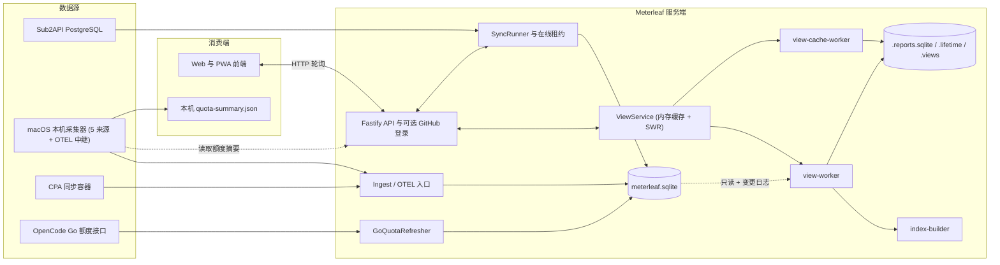

# 整体架构

[返回首页](../README.md) · [贡献指南](../AGENTS.md)

Meterleaf 是单容器运行的独立 AI 用量账本，只读采集上游网关和本机工具的用量与额度，在本地 SQLite 中独立计价、汇总和展示。它不代理模型请求、不修改上游数据，也不直接调用模型供应商接口（OpenCode Go 额度接口除外）。

## 组件与目录边界

| 目录                  | 语言 / 运行时             | 职责与边界                                                                                                            |
| --------------------- | ------------------------- | --------------------------------------------------------------------------------------------------------------------- |
| `src/connectors`      | TypeScript / Bun          | 服务端只读拉取连接器，目前解释 Sub2API PostgreSQL 的 `public.accounts` 与 `public.usage_logs`                         |
| `src/collector`       | TypeScript / Bun + Swift  | macOS 本机采集器与 `Meterleaf.app` 托管服务，读取五种本地工具记录、托管本机 OTEL 中继、拉取额度摘要并调度用户额外任务 |
| `collectors/cpa`      | Python 3.11+              | 独立可选的 CPA 同步容器，只读扫描 CLIProxyAPI 的 `usage-report` SQLite 账本并推送到服务端，不参与主容器构建           |
| `src/domain`          | TypeScript                | 纯领域规则：互斥 Token 桶、多分支独立计价、账户合并视图与多段百分比额度预估，不依赖数据库或上游列名                   |
| `src/storage`         | TypeScript / `bun:sqlite` | SQLite 持久化、版本链迁移、事实账本写入、报表索引、累计索引与视图缓存存取                                             |
| `src/server`          | TypeScript / Fastify      | HTTP API、可选 GitHub OAuth 登录、采集器写入与 OTEL 入口、Sub2API 定时同步、OpenCode Go 额度轮询及多线程报表服务      |
| `src/shared`          | TypeScript                | 服务端、前端与采集器共享的数据契约、线协议编码与查询校验                                                              |
| `src/web` 与 `public` | React 19 / Vite           | 桌面与移动端前端、ECharts 图表、设计令牌与 PWA 静态壳 Service Worker                                                  |
| `prices`              | TypeScript + JSON         | 声明式费率源表 `catalog.ts` 与编译生成的版本化价格表 `meterleaf.json`                                                 |
| `scripts`             | TypeScript / Bash / Swift | 采集器打包、前端静态资源预压缩、价格表构建与对账、发布校验及本机辅助脚本                                              |

`collectors/cpa` 位于仓库根目录而非 `src/`，因为它通过 `compose.cpa.yaml` 以只读卷挂载进独立的 `python:3.12-alpine` 容器运行，不应随 `Dockerfile` 中的 `COPY src ./src` 进入主服务端镜像。

## 核心数据流

### 1. 写入与采集

- **Sub2API 拉取**（`src/server/sync.ts`）：受 `SyncPresence` 在线租约控制。任一页面可见时按可见间隔同步（默认 15 秒），无页面可见时退回低频间隔（默认 15 分钟），减少 NAS 磁盘写入。
- **macOS 本机采集器**（`src/collector/`）：由单个 `Meterleaf.app` 通过 `SMAppService` 托管两个后台任务——每分钟一次的低优先级同步任务和常驻的本机 OTEL 中继（`127.0.0.1:4319`）。单轮同步在排他锁 `sync.lock` 下依次读取 Claude Code、Codex、OpenCode、Antigravity CLI 与 omp，写入本地 SQLite 待发送队列（`state.sqlite`），统一推送到 `/api/otel/v1/logs` 与 `/api/ingest/v1/batches`，推送成功后拉取 `/api/collector/v1/quota-summary` 原子写出 `quota-summary.json`，最后在 `finally` 中顺序运行到期的用户额外任务。
- **Claude Code 账户归属**（`src/storage/ledger.ts`）：采集器给每条用量标上来源（模型映射 `model` 或登录时间线 `timeline`），会话记录里有有效会话 ID 时一并带上；服务端按优先级 `model` > `otel` > `session` > 时间线或未归属确定账户。`otel` 来自 `claude_code.api_request` 与 `claude_code.api_error` 的同一请求 ID；`session` 只在采集器报为未归属、带有效会话 ID 且没有精确 OTEL 时推断：同一会话里前后最近两条带账户的 OTEL 请求属于同一账户，两侧间隔都不超过 30 分钟，且任一侧最近时刻没有并列的其他账户。两种结论都写进用量事实，请求归属记录过期或采集器重发时不回退；精确 OTEL 晚到时把 `session` 升级为 `otel`，邻居请求晚于用量到达时也会补做推断。
- **CPA 伴随容器**（`collectors/cpa/bridge.py`）：复用 `METERLEAF_INGEST_KEYS` 向 `/api/ingest/v1/batches` 推送幂等批次，游标、已送达与拒收记录保存在独立的 `cpa_data/state.sqlite`。
- **OpenCode Go 额度**（`src/server/opencode-go.ts`）：仅在配置了密钥且有页面在线时轮询，最多每 2 分钟请求一次，读数无变化时最多每 4 分钟写一次盘。

### 2. 存储四库与多线程报表引擎

数据目录包含一个事实库和三个可随时从事实库重建的派生文件：

| 文件                                       | 角色                                                                                                                    | 是否需要备份 |
| ------------------------------------------ | ----------------------------------------------------------------------------------------------------------------------- | ------------ |
| `meterleaf.sqlite`                         | 事实账本：用量事实、账户与额度快照、价格表快照、估值、账户管理状态（归档/隐藏/别名/套餐/合并）、OTEL 归属与用量变更日志 | 必须备份     |
| `meterleaf.sqlite.reports.sqlite`          | 按时间与维度预聚合的主报表索引                                                                                          | 可重建       |
| `meterleaf.sqlite.reports.sqlite.lifetime` | 历史至今累计与账户累计索引                                                                                              | 可重建       |
| `meterleaf.sqlite.reports.sqlite.views`    | 持久化视图缓存，用于冷启动时立即响应                                                                                    | 可重建       |

服务端在主线程与三个后台线程间分工协作：

- **主线程 `ViewService`**（`src/server/view-service.ts`）：持有内存视图缓存，采用先返回上次成功结果再后台刷新（SWR）的策略，避免阻塞 HTTP 请求。
- **报表线程 `view-worker`**（`src/server/view-worker.ts`）：以只读连接打开 `meterleaf.sqlite`，负责执行报表查询与增量补齐。当待补变更不超过 2000 条时，查询把待补变更应用到一个最终回滚的事务里直接出数，不在读取时反复刷盘；真正的索引提交交给每小时一次的定时补齐任务，待补变更超过 2000 条时才由读取直接提交。
- **重建线程 `index-builder`**（`src/server/index-builder.ts`）：当账本事实达到全量重建阈值（2000 条及以上）且遇到价格表变更、账户合并归属变化、索引结构变化、账本替换或变更日志已被清理时，在后台独立线程中构建 `.next` 索引文件并在完成后原子替换。重建期间若旧索引仍对应同一账本且价格版本已知，查询继续返回旧结果并标记为刷新中；否则返回 HTTP `202`（计算中）。
- **缓存写线程 `view-cache-worker`**（`src/server/view-cache-worker.ts`）：将主线程的新报表异步批量写入 `.views` 数据库。
- **自动清理**：旧价格表版本的估值在服务启动后异步清理一次（`pruneStaleValuations`）；已被报表索引和累计索引共同消费的变更日志在运行期间每小时最多清理一次，并在后台全量重建完成后清理（`pruneUsageChangeLog`）。

### 3. 前端与实时更新

- **四页面结构**：用量总览、统计报表（含「用量与费用」与「响应性能」双视角）、请求明细、关于。
- **实时更新采用 HTTP 轮询而非 SSE**：
  - 状态与心跳轮询（`src/web/components/SyncControl.tsx`）：页面可见时定时请求 `POST /api/sync/presence`，同步运行中每 3 秒一次，空闲或出错时每 15 秒一次；后端同步状态与账本版本号（`ledger.revision`）随响应返回，版本号变化时前端使旧报表缓存失效。页面切入后台或会话过期时停止轮询，关闭或隐藏时通过 `navigator.sendBeacon` 上报离开。
  - 报表构建过渡轮询（`src/web/lib/report-building.ts`）：平时不轮询 `GET /api/view`，只在后端返回 `202`（每 2 秒）、返回旧结果且 `refreshing` 为真（每 1 秒）或首屏断网（每 3 秒）时轮询。
- **PWA 与弱网保护**（`public/sw.js`、`public/offline.html`）：Service Worker 禁用导航预加载，仅缓存静态前端壳，绝不缓存 `/api/*` 或账本数据。普通页面导航 350 毫秒未返回时回退到本地静态壳，由前端以 6 秒首屏超时请求 `/api/view` 并自动换新连接重试一次；认证路径 `/auth/*` 与离线重连探测使用 8 秒导航超时。

## 认证与信任边界

- **网页与读取接口**：配置 `METERLEAF_GITHUB_*` 四项后启用内置 GitHub OAuth 登录，会话保存在 HMAC-SHA256 签名的 HttpOnly Cookie 中，使用满 1 天自动顺延，每次请求核对用户名仍在允许名单内。未配置时服务自身不鉴权，默认仅绑定回环地址，对外开放需由反向代理或内置登录保护。
- **推送与摘要接口**：`POST /api/ingest/v1/batches`、`POST /api/otel/v1/logs` 与 `GET /api/collector/v1/quota-summary` 绕过 GitHub 登录，独立使用 `METERLEAF_INGEST_KEYS` 校验 Bearer 密钥的 SHA-256 摘要。每个密钥只能写入自己绑定的 `sourceId`；额度摘要接口只返回在用订阅账户的展示名、套餐和窗口，不暴露账本明细或其他接口。
- **数据库结构版本**：`src/storage/schema.ts` 以线性父链管理四个 SQLite 文件的 revision。账本主库升级到新 `DATABASE_SCHEMA_REVISION` 后旧镜像无法读取；三个派生库保持基线版本，可在需要时删除重建。
