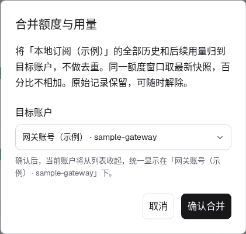

# 使用与报表

[返回首页](../README.md)

## 四个页面

| 页面     | 内容                                                                                                                            | 时间范围                                     |
| -------- | ------------------------------------------------------------------------------------------------------------------------------- | -------------------------------------------- |
| 用量总览 | 所选范围的摘要、账户额度与账户管理、消耗趋势与模型分布                                                                          | 默认历史至今，可切换，账户额度始终按当前周期 |
| 统计报表 | 范围摘要、模型分布与分组汇总（支持「用量与费用」和「响应性能」双视角）                                                          | 按本页日期和筛选条件                         |
| 请求明细 | 模型、推理强度、账户、Token 拆分、缓存命中率、首 Token 延迟、总耗时与费用；支持按屏宽自适应列、预设与每页行数；点击查看完整详情 | 按本页条件筛选并在服务端分页                 |
| 关于     | 明暗主题、强调配色、移动端布局切换、数据模式说明，以及 GitHub 登录账号与退出入口                                                | 不受时间范围影响                             |

总览的账户区列出每个账户的周期百分比、重置时间、Tokens、请求数、估算费用与整周期预估，并附本周期的缓存命中率。命中率与统计报表同一口径，即缓存读取占输入、缓存读取、缓存写入三项之和的比例，只计三项都已知的请求；周期内还没有这类请求时不显示。无额度快照的账户优先展示历史累计，缺少累计时才使用当前区间汇总。点击有额度的账户打开额度详情抽屉，点击其它账户打开它的请求明细。API 接入只表示接入方式，有快照时仍可展示订阅额度。

总览只按时间切换，不按模型或账户筛选。第一眼是总量和账户额度，默认范围「历史至今」从账本第一条记录起算。换成今天、近 7 天、近 30 天或自定义日期后，摘要、趋势和模型分布一起变化，账户额度仍按各自当前周期显示，不受范围影响。

摘要有四格。

- **Tokens**，历史至今下显示日均，其它范围显示环比（上期无用量时显示「暂无对比」）；桌面端与统计报表同格附带单次请求均值与输出 Tokens。
- **费用**，历史至今下显示日均，其它范围显示环比；总览在「历史至今」且使用订阅等价口径时，附注一并给出标准 API 金额供对照。
- **请求**，历史至今下显示账本起始日期，其它范围显示环比。
- **缓存命中率**，表示缓存读取占输入侧（普通输入、缓存读取、缓存写入）的比例，下方条形图按这三部分拆开，输出 Tokens 不计入命中率（手机首页在条形图下方列出输出数量）。

趋势图下方给出峰值时段、有用量的时段数和单次请求平均值。点击总览模型分布中的模型，会带着同一范围打开统计报表。

统计报表顶部使用同样的摘要，中间的模型分布表格支持排序，点击模型会带着筛选条件打开请求明细。下方的分组汇总支持两种视角切换，按小时、天、周、模型或账户分组，多于一行时末尾显示合计行：

- **用量与费用**，展示 Tokens 拆分、缓存命中率、请求数和估算费用。
- **响应性能**，搭配性能组合图，展示请求数、有效样本数、平均首字延迟、平均总耗时与生成速度（tok/s），合计行按有效样本加权汇总。

请求明细列表支持按时间、模型、账户、输入、缓存读取、缓存命中率、输出和费用排序；来源标识、源记录 ID、请求/发送/响应模型、首字延迟、总耗时、生成速度、服务档位和网关扣费在点击条目打开详情抽屉后查看。

手机默认使用 App 模式，底部为首页、统计、明细和关于。首页顶部可在全部、近 7 天和近 30 天之间切换，日历按钮提供其它范围。可在「关于」中切换为侧栏模式；导航模式和主题会记住，重新打开仍然生效。

## 筛选与图表

快捷范围与自定义起止日期均支持，快捷范围的第一项是「历史至今」；完整有效的日期修改立即生效，无需应用按钮。自然日和自然周按 `Asia/Shanghai` 统计。

各页面独立记住日期、模型、账户、图表选项及适用的汇总维度、视角和排序。搜索关键词和分页不保存。

主题、USD 估算口径和账户顺序全局共享。主题可以跟随系统，也可手动选择浅色或深色。配色与明暗相互独立，提供翠绿、靛蓝和黑白三种。

支持 PWA 的浏览器可使用原生安装入口，将 Meterleaf 安装为独立窗口。离线缓存仅保存静态前端壳，绝不缓存账本数据；断网或网络卡住时只显示连不上的提示，绝不展示旧账本，网络恢复后自动重读当前账本，也可以点击「重新读取」或「重新连接」立即再试（超时与静态壳回退细节见[整体架构](architecture.md#3-前端与实时更新)）。

消耗趋势支持小时、天、周粒度，可切换柱状图、折线图和面积图，饼图展示模型占比，不表示时间变化。USD 和 Tokens 使用同一份报表结果切换。

## 账户管理

账户管理都在总览的账户区完成，手机首页相同。

- 点击标题右侧的「排序」后，每个账户右侧出现拖拽手柄，可直接拖动账户或使用方向键调整顺序，点「完成」结束。新账户追加在末尾。
- 每个账户右侧的「⋯」菜单提供合并额度与用量、重命名、设置套餐、归档和删除。设置套餐对 Claude、Codex 和 Antigravity 账户显示。
- 同一账号从多个来源采集时，在来源账户菜单选择「合并额度与用量」，选定目标账户后确认。全部历史及后续用量都会归入目标，原来源记录仍可在请求明细查看，不做跨来源去重；若两个来源都记录了同一次请求，会累计两次。同一额度窗口使用最新快照，百分比不会相加，未知或到期状态仍如实显示。目标账户的名称和套餐保留。
- 在目标账户的「合并额度与用量」弹窗查看已合并账户，点击「解除合并」恢复各自展示。原始记录不删除，同步不会覆盖合并关系；连续合并多个账户时，解除某一层也会带回合并到它的账户。合并和解除后报表需要重新计算，数据较多时稍等片刻。
- 归档账户不在账户区显示。有归档账户时，标题右侧出现「已归档 N」，点击后查看归档列表，可在菜单中恢复或删除，点「使用中账户」返回。
- 归档与已删除账户都不再出现在统计报表和请求明细的账户筛选里。从归档列表打开某个账户的请求时，筛选仍保留这个账户并注明「已归档」，切回「全部账户」即可退出。
- 删除账户只移除账户展示，不会删除历史请求、累计统计，也不影响 Sub2API 或本机采集器。
- 重命名的名称只在 Meterleaf 中显示，最长 40 个字，不会改动上游。清空名称或选择恢复原名后，重新显示上游提供的名称。
- 套餐徽标按使用倍数分三档显示，同一档外观相同。Claude Pro、Claude Team Standard、ChatGPT Plus 与 Google AI Pro 为一档，Claude Max、Claude Team Premium、ChatGPT Pro 10x 与 Google AI Ultra 5x 为二档，Claude Ultra、ChatGPT Pro 20x / Pro 50x 与 Google AI Ultra 20x 为三档。Claude 的 Max 与 Ultra 对应原来的 Max 5x 与 Max 20x。只知道订阅类型、不知道倍数时（例如 Max、Team、Business），以及 ChatGPT Free、ChatGPT Go、Google AI Plus、OpenCode Go / Go Plus 等低于一档或未分档套餐，只显示名称、不分档。
- 采集器读不到套餐时，例如账户已不在这台电脑上登录，可以在「设置套餐」里选择对应平台的套餐（Claude 支持 `Pro / Max / Ultra / Team Standard / Team Premium`，Codex 支持 `Go / Plus / Pro 10x / Pro 20x / Pro 50x / Team / Business`，Google 支持 `Plus / Pro / Ultra 5x / Ultra 20x`），选「自动识别」恢复采集器上报的套餐。Antigravity 只报出 Google AI Ultra、不区分倍数，可在「设置套餐」里选 Ultra 5x 或 Ultra 20x。设置只保存在 Meterleaf 中，不会被同步覆盖，也不会让本周期的额度预估重新起算。
- 本地归档、删除状态和账户名称不会被同步覆盖。上游删除账户后，本地历史请求仍保留。

## 额度与金额

5 小时、7 天、Fable 周额度与月度（1m）窗口独立显示，过期窗口不沿用上一周期的百分比和统计。

- **Claude Fable 周额度**，上报了 Fable 周额度时在 7 天窗口下方单独显示一行，只统计 Fable 模型的请求，没有上报时不显示，也不按套餐推断。
- **Antigravity 双额度池**，Google 账户的 Gemini 与 Claude/GPT 两个额度池显示在同一张卡片里，先列 Gemini 的 5 小时与 7 天窗口，再列 Claude 的两个窗口，每个池的费用只计自己的模型。桌面卡片右侧的 7 天预估对应 Gemini 池，Claude 池的预估在账户详情抽屉里查看。
- **OpenCode Go 月度窗口**，在 7 天窗口之后显示「1m」月度窗口，到期后隐藏并与其他周期窗口一样参与整周期预估。
- **用满与等待更新**，在移动端或紧凑视图下，某个账户（或 Antigravity 的单个额度池）的 7 天额度用满时会收起对应的 5 小时窗口（以及 Fable 或月度窗口），桌面宽视图则保留仍有效的 5 小时窗口。当同一账户的其他窗口有效而某窗口刚结束且尚未收到新周期读数时，该窗口保留位置并显示「等待更新」（适用于 5 小时、7 天及 Fable 窗口），收到新周期数据后恢复。页面停留或从后台恢复时都会重新检查到期时间。

整周期预估（适用于 7 天、Fable、Claude 池 7 天及月度 1m 窗口；5 小时窗口不做预估）表示用满本周期额度时预计的总花费，等于本周期已花金额加上剩余百分比按每 1% 花费推算的金额。用得越多，需要推算的部分越少，用满时预估就是已花金额。同样的 1% 折算成美元并不固定，例如上下文较长、缓存读取较多的请求按 API 价格更贵，所以周期初期的预估会随用法变化。每 1% 花费比较当前周期内多个额度快照之间的费用与百分比变化，每段至少跨越 5 个百分点，积累至少 3 个有效点对后取中位数。同一百分比的重复采样不会增加权重。上游百分比是四舍五入后的整数，刚从 k-1 变为 k 的时刻按 k-0.5 计算，避免周期初期低估。

同一周期内百分比只会上升。同时开着多个 Claude Code 会话时，某个会话可能写入它较早看到的额度，使百分比暂时回落几个点。这类小幅回落按过时读数忽略，进度和预估都保持此前的最高值；重置时间按最接近的整分钟归入同一周期。

本周期观测较少时，只在同一来源、同一已知套餐的连续观测区间内参考上一周期。有足够的多段观测后随当前观测跨度增加逐步调整，跨度达到 20 个百分点后完全使用本周期数据。上一周期也没有足够多段观测时，只有已观测到至少 10% 才把其加权粗估作为参考。没有可用历史时，按本周期不同百分比的累计消费加权粗估，较高百分比权重更大。账户详情抽屉会说明估算依据。周期重置后重新积累当前样本，不参考久远周期。

只有两个不同的已知套餐之间才算套餐变化。之前不知道套餐、后来识别出或手动设置了套餐，只是补上一直成立的标签，本周期已有的读数和花费继续参与预估；暂时读不到套餐也不算变化。服务端发现套餐变化后立即停止参考旧套餐，只用之后的新快照计算消费和百分比增量；百分比大幅回退（至少 5 个百分点且不高于此前最高值一半）也会重新取基准。Claude Code 只在打开 `/usage` 等刷新账户资料时更新套餐，升级时上游通常已先把百分比清零，这次清零就作为新套餐的起点，清零后首个百分比读数即可开始粗估。没有清零、还没有两个可比较的新点时暂时无法估算，有有效增量后恢复粗估。周期累计用量仍保留变化前后的全部消费，已花金额也包含变化前的消费，所以该周期的预估偏高，下个周期恢复正常。套餐观测记录从升级后开始积累，不把当前套餐补写到旧快照，也不把服务端发现时间当作上游实际生效时间。上游没有提供套餐信息或套餐标签不变的额度调整，无法保证即时识别。

手机上预估跟在已用费用之后，桌面账户列表在右侧单独显示。缺少有效比例、可计价消费或窗口失效时保留未知，不补零。快照可能包含其他入口的消费，本地请求只覆盖已采集来源，模型组合和供应商计量规则也可能变化，因此估值不是供应商承诺额度。

金额按大小显示：常规金额保留两位小数，低于一美分时多显示几位有效数字并省略末尾的零，低价模型的单次费用不会都显示成 $0.00。

Tokens 总量由普通输入、缓存读取、缓存写入和输出组成。推理 Tokens 是输出子集，不能再相加。缺失金额保留未知，可计价部分的合计不代表完整费用。两种美元口径的区别见[计价说明](pricing.md)。

## 更新与失败提示

页面会自动检查账本变化，有新数据时更新报表，回到页面时立即检查。右上角显示最近成功接收数据或完成同步的时间，可在「数据同步」中暂停页面自动更新；暂停不会停止采集器推送或后台同步。

连接了 Sub2API 时，还可从「数据同步」启动采集或开启自动同步。只接入本机采集器时显示推送状态，不提供拉取同步按钮；采集器自身的状态在那台电脑上用 `meterleaf-collector status` 查看。同步失败不会用演示数据替换已有账本。

后台刷新期间保留上次成功报表。首次查询没有缓存时仍需等待；读取失败与上游同步失败是不同问题，按提示说明的出错步骤排查，不要先清库。部署与日志操作见[部署指南](deployment.md)。

## 当前边界

请求详情按来源证据展示模型、推理强度、服务档位、首字延迟、总耗时和生成速度等字段，缺失字段不补默认值。当前尚不提供 CSV 导出入口、用户/API Key/网关分组统计、RPM/TPM 或错误率报表。

Meterleaf 是独立用量账本，不是 Sub2API 管理面板的复刻；网关扣费与独立估值不能混为一个指标。
